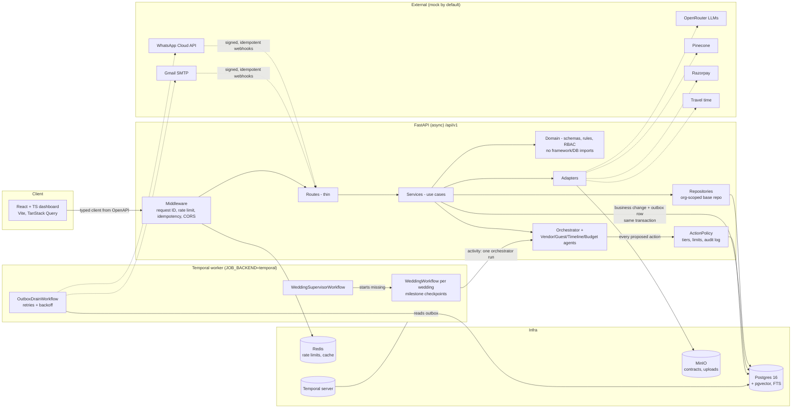

# Wedding AI Operating Layer

An AI operating layer for **wedding planning companies in India**. It automates the repetitive parts of running many weddings at once:

1. **Vendor discovery and contracting** (the core workflow): hybrid search, price benchmarks, and contract clause extraction with risk flags.
2. **Guest management and RSVP**: CSV/XLSX import, multilingual invites and reminders, RSVP webhooks, and attendance forecasts.
3. **Timeline and logistics**: multi-day timelines (Mehendi, Haldi, Sangeet, Wedding, Reception) with buffers and conflict detection.
4. **Budget**: planned vs. actual per category, threshold alerts, and an ML spend forecast.

It is a multi-tenant B2B system. Each planning company is an *organization*, and its data is strictly isolated from other organizations.

The AI is **assistive by default**. It recommends, and a person approves. It runs **fully offline with no API keys**: every external service has a mock implementation, and that mock is the default.

> The full scope lives in [`docs/BUILD_PROMPT.md`](docs/BUILD_PROMPT.md). Every assumption and deviation is recorded in [`DECISIONS.md`](DECISIONS.md).

---

## Project status

The build follows three phases (see [`docs/BUILD_PROMPT.md`](docs/BUILD_PROMPT.md) §9).

| Phase | Scope | Status |
|---|---|---|
| **1 – MVP** | Repo tooling, Docker stack, FastAPI `/api/v1`, health checks, RFC 9457 errors, multi-tenancy, JWT + RBAC, models + migrations, seed data, vendor search, guest import, timeline templates, mock LLM/messaging, generated TS client, React dashboard | ✅ Implemented |
| **2 – Learning** | Multilingual embeddings + hybrid RRF search with explanations, price benchmarks, contract analysis with quote verification, budget forecast model, transactional outbox + dispatcher, idempotent webhooks/endpoints, templates + reminder rules, OpenRouter client + model router + cost logging, token budgets | ✅ Implemented |
| **3 – Autonomous** | Temporal workflows, `ActionPolicy` autonomy tiers, approval queue, audit log + rollback, agents + orchestrator, auto-fixes within limits, Prometheus `/metrics`, Sentry hook, Approvals and Activity pages | ✅ Implemented |
| **Eval** | `eval/` offline scripts: precision@5 / recall@10, contract field accuracy, RSVP correctness, p95 latency, cost per wedding | 🚧 Not started |

---

## Quick start

**Prerequisites:** Docker with Compose v2. For local development without containers, you also need [uv](https://docs.astral.sh/uv/) and Node 22.

```bash
git clone <this-repo> && cd wedding_planner
cp .env.example .env        # optional: every value has a working dev default
make up                     # postgres+pgvector, redis, minio, api, frontend (waits for health)
make seed                   # synthetic data: 2 orgs, ~300 vendors, 3 weddings, ~600 guests, 5 contracts
```

| What | URL |
|---|---|
| Dashboard | http://localhost:5173 |
| API docs (Swagger) | http://localhost:8000/api/docs |
| OpenAPI schema | http://localhost:8000/api/v1/openapi.json |
| Health | http://localhost:8000/health/live, http://localhost:8000/health/ready |
| MinIO console | http://localhost:9001 (`minioadmin` / `minioadmin`) |

**Seed logins** (dev only). Every user's password is `Password123!`.

| Organization | Users |
|---|---|
| Shubh Vivah Planners | `admin@shubh-vivah.example`, `planner@shubh-vivah.example`, `viewer@shubh-vivah.example`, `client.<city>@shubh-vivah.example` |
| Royal Knots Weddings | `admin@royal-knots.example`, `planner@royal-knots.example`, `viewer@royal-knots.example`, `client.<city>@royal-knots.example` |

All seed people, companies and vendors are **synthetic** and flagged `is_synthetic`.

### Make targets

| Target | Does |
|---|---|
| `make dev` / `make up` / `make down` | Start the stack (foreground / background) / stop it |
| `make infra` | Start only Postgres, Redis, MinIO (for local tests) |
| `make seed` | Wipe and reload synthetic seed data (idempotent) |
| `make test` | Backend pytest (real Postgres + Redis) and frontend Vitest |
| `make lint` | ruff + ESLint + Prettier |
| `make typecheck` | mypy (strict on `app/domain`, `app/services`) + `tsc --noEmit` |
| `make gen-client` | Export OpenAPI and regenerate the typed frontend client |
| `make hooks` | Install pre-commit hooks |

---

## Architecture



### Backend layout (ports and adapters)

```
backend/app/
├── api/v1/        HTTP routes only: validation + calling services
├── services/      use cases: vendor search, contracts, guests, messaging, timeline, budget, LLM gateway, outbox
├── domain/        entities, Pydantic schemas, policies (RBAC, guest rules, pricing, timeline, contracts)
├── ports/         interfaces: LLMClient, MessagingChannel, VectorStore, ObjectStorage, Embedder, Payments, TravelTime
├── adapters/      implementations: mock (default) + real (OpenRouter, WhatsApp, Gmail SMTP, pgvector, Pinecone, MinIO, sentence-transformers)
├── repositories/  all DB access; base repository applies the organization filter automatically
├── db/            SQLAlchemy 2 models, session, encrypted column types
├── jobs/          outbox dispatcher + handlers; `backend.py` picks the one job system (in-process or Temporal)
├── ml/            scikit-learn budget forecast
├── core/          config, logging, errors, security, crypto, idempotency, middleware
├── agents/        orchestrator + Vendor, Guest, Timeline, Budget agents (tools registered with their tier)
└── workflows/     Temporal workflows, activities, worker
```

Dependencies point inward: routes → services → domain. The domain never imports adapters, and FastAPI dependency injection wires in the concrete implementations (`app/adapters/factory.py`).

### Key design principles

- **Multi-tenancy.** Every tenant-owned table has a non-null, indexed `organization_id`. The base repository scopes every query to the caller's organization, so isolation never depends on remembering a `WHERE` clause. Vendors are a shared global catalogue plus org-private vendors. Everything else is org-private. Tests in `tests/security/test_tenant_isolation.py` cover this.
- **RBAC.** There are four roles: `org_admin`, `planner`, `viewer` and `client` (the couple, read-only on their own wedding). All four are enforced in a single policy layer (`app/domain/rbac.py` + the `require()` dependency).
- **Consistent errors.** Every error is an RFC 9457 `application/problem+json` response that carries the request ID.
- **Idempotency.**
  - Mutating POSTs accept an `Idempotency-Key` header.
  - Incoming webhooks are deduplicated by provider message ID through a unique constraint.
  - Outgoing messages carry a deterministic dedupe key (guest + event + template + reminder number).
- **Transactional outbox.** No external call is ever made inside a DB transaction. The business change and an `outbox_events` row commit together. The dispatcher then sends with exponential backoff. Dead events appear in `GET /api/v1/admin/outbox` and can be retried.
- **Structured output.** Every LLM output the system acts on is validated against a Pydantic schema. On a validation failure it retries once with the error, then falls back to rule-based logic and flags the item for human review.
- **Observability.** Structured JSON logs (structlog) carry a correlation ID, with PII masked. Prometheus metrics are served at `/metrics` by the API (HTTP, agent actions, outbox, LLM tokens and cost) and on port 9100 by the Temporal worker. The Sentry SDK is disabled when there is no DSN.
- **Unit of work.** Each request's DB session commits *before* the response is sent (`Depends(get_db, scope="function")`). A client never sees a 200 for a write that isn't committed yet, and a failed commit becomes an error response.

---

## Features

### Vendor discovery and contracting (core)
- **Hybrid search.** Postgres full-text search (BM25-style) and dense vector search (pgvector) are merged with **Reciprocal Rank Fusion**. Results are then filtered by hard constraints (city, date availability, budget) and ranked.
- **Explainability.** Every recommendation says *why*: matched styles, price vs. budget, availability and rating.
- **Price benchmarking.** Shows p25, median and p75 per category and city, and where a quote sits in that range.
- **Contract analysis.**
  - Upload a PDF or DOCX. Its text is extracted.
  - The LLM pulls out the payment schedule, cancellation, refund, liability, force majeure and deliverables clauses.
  - Rule-based risk flags fire, for example a non-refundable advance over 50% or a missing cancellation clause.
  - **Every clause must quote its source span.** If the quote isn't found in the document, it is flagged as a possible hallucination.
- **The human decides.** Shortlisting and final selection always need a person's click. Cancelling a contract is a Tier 3, human-only action.

### Guests and RSVP
- **Import.** CSV/XLSX import produces a per-row error report covering bad phone numbers and duplicates. Phones are normalised to E.164 with `phonenumbers`.
- **Messaging.** Templates are seeded in English and Hindi. WhatsApp and email both run behind the `MessagingChannel` interface. Every send goes through the outbox.
- **Reminder rules.** Remind after N days with no reply, send at most M reminders, and never send during quiet hours (21:00–09:00 IST). All of this is set in `config/policy.yaml`.
- **RSVP webhooks.** Webhooks verify the provider's signature and are idempotent. In mock mode, `simulate-reply` stands in for a guest's answer.
- **Attendance forecast.** A heuristic gives an expected headcount range per event.

### Timeline and logistics
- Generates a draft multi-day timeline from the wedding's events and its booked vendors. Buffers come from `config/timeline_templates.yaml`.
- Detects these conflicts:
  - overlapping items
  - a vendor double-booked
  - missing setup time
  - not enough travel time between venues (mock travel-time provider)

### Budget
- Tracks planned vs. actual spend per category, with alerts at a configurable threshold (90% by default).
- Forecasts final spend with a scikit-learn regression trained on seed data. There is a hook for Vertex AutoML later.

### Agents and autonomy (Phase 3)
- **Orchestrator + four agents** (`app/agents/`). Each agent proposes actions through explicit tools, and every tool is registered with its tier. `GET /api/v1/agents/tools` lists them.
- **`ActionPolicy`** (`app/services/action_policy.py`, rules in `app/domain/autonomy.py`). Every agent action passes through it before anything runs:
  - **Tier 1** (RSVP reminders, guest status, timeline drafts, vendor suggestions, budget alerts): runs and is logged.
  - **Tier 2** (reschedule a vendor slot, adjust the timeline, accept a price change): runs only within `config/policy.yaml` limits (shift ≤ 48 h, price change ≤ 5%). Outside the limits it becomes an approval request instead. Every Tier 2 tool is reversible.
  - **Tier 3** (cancel contracts, change legal terms, payments): always blocked for agents. The attempt is logged and raises an error.
  - Low confidence or a validation failure escalates to a person; the agent never guesses.
- **Approvals queue.** Routine requests need `approval:decide` (planners). Approving a Tier 2 action *outside* its limits needs `approval:decide_override` (org admins).
- **Audit log + undo.** Every attempt is written to `agent_actions` with its before and after state. Executed Tier 2 actions can be undone from the Agent activity page.
- **Temporal.** With `JOB_BACKEND=temporal` (the docker compose default), each wedding runs as a long-lived `WeddingWorkflow` that runs the agents on a schedule or when nudged, and checkpoints milestones (vendors booked, invites sent, timeline locked). The outbox drain runs as a workflow too, and the in-process worker is switched off, so only one job system runs. `JOB_BACKEND=inprocess` keeps the Phase 2 behaviour with no extra services.
- **UI.** The Approvals and Agent activity pages exist per wedding and org-wide. Every row says whether the AI or a person acted.

### Guardrails
- **Token budget.** Each user has a monthly token budget (default 1M). It warns at 80% and throttles at 100%.
- **Prompt-injection defence** (`app/domain/untrusted.py`). Guest replies, vendor descriptions and contract text are treated as untrusted. They are kept apart from instructions and stripped of suspicious directives.
- **PII.** Phone and email columns are encrypted at rest (Fernet) with a separate HMAC hash for lookups, and masked in logs.

---

## AI models

Model IDs live **only** in [`config/models.yaml`](config/models.yaml). The router picks a model tier per task:

| Task | Tier | Model (as of 2026-10-16) |
|---|---|---|
| `guest_comm`, `general` | fast | `google/gemini-3.5-flash-lite` |
| `contract_analysis`, `timeline_reasoning` | strong | `google/gemini-3.1-pro-preview` |
| any task, on errors | fallback | `openai/gpt-5-mini` |

Every call logs the chosen model, its token counts and its estimated cost (USD → INR) to `token_usage`.

Embeddings run locally with **`paraphrase-multilingual-MiniLM-L12-v2`** (384-dim). It handles Hindi and other Indian languages, unlike the English-only `all-MiniLM-L6-v2`. Tests and CI use a deterministic hash embedder instead (`EMBEDDING_PROVIDER=hash`).

---

## Enabling real providers

Everything is mocked until you set the matching key in `.env`. After setting a key, restart the API with `make up`.

| Provider | Set | Effect |
|---|---|---|
| LLMs (OpenRouter) | `OPENROUTER_API_KEY` | `OpenRouterLLM` replaces `MockLLM` |
| WhatsApp Cloud API | `WHATSAPP_ACCESS_TOKEN`, `WHATSAPP_PHONE_NUMBER_ID`, `WHATSAPP_APP_SECRET`, `WHATSAPP_VERIFY_TOKEN` | Real WhatsApp sends + signed webhook verification |
| Email | `GMAIL_SMTP_USER`, `GMAIL_SMTP_APP_PASSWORD` | Gmail SMTP with an app password |
| Pinecone | `PINECONE_API_KEY`, `PINECONE_INDEX` | Pinecone replaces pgvector as the vector store |
| Embeddings | `EMBEDDING_PROVIDER=sentence_transformers` | Real multilingual model (downloads ~470 MB on first use) |
| Razorpay / Google Calendar | `RAZORPAY_KEY_ID` / `RAZORPAY_KEY_SECRET`, `GOOGLE_CALENDAR_CREDENTIALS_FILE` | Reserved; mock implementations only for now |
| Sentry | `SENTRY_DSN` | Error reporting on |

With `APP_ENV=production`, the app **refuses to start** on the dev secrets (`JWT_SECRET`, `PII_ENCRYPTION_KEY`, `PII_HASH_KEY`). Generate fresh ones with the commands in `.env.example`.

---

## Testing and quality

The backend tests run against real Postgres (with pgvector) and Redis:

```bash
make infra            # start postgres, redis, minio
make test-backend     # uv run pytest -q
make test-frontend    # vitest
make lint typecheck
```

| Suite | Covers |
|---|---|
| `tests/unit` | Domain rules: phone normalisation, guest rules, pricing, timeline conflicts, contract risk rules, RRF |
| `tests/unit` (autonomy) | Tier rules and limits in isolation |
| `tests/integration` | Search + benchmarks + forecast, contracts + LLM fallback, outbox + messaging retries, idempotency + webhooks, platform/health, **ActionPolicy** (Tier 3 impossible for agents, Tier 2 limits + undo, approvals), **Temporal workflows** (time-skipping test server), request unit of work |
| `tests/security` | **Tenant isolation** across endpoints; **RBAC** per role |
| `tests/e2e` | One end-to-end flow per workflow (vendor, guests/RSVP, timeline, budget, agents) |
| `frontend/src/**/*.test.ts(x)` | Vitest component and formatting tests |
| `frontend/e2e` | Playwright against the live stack: login, vendor search + shortlist, approvals (planner vs. admin), undo from the activity log, viewer is read-only. Run `make up && make seed`, then `make test-e2e`. Reseed before each run, because the specs change data. |

**CI** (`.github/workflows/ci.yml`) runs on every push and PR. The backend job runs ruff, mypy and pytest with Postgres and Redis service containers, and the frontend job runs ESLint, `tsc` and Vitest, then builds. Pre-commit hooks (`.pre-commit-config.yaml`) run the same pinned tools.

**Pinned versions.** Python is 3.12 with exact pins in `pyproject.toml` + `uv.lock`. npm packages are pinned via `package-lock.json`. GitHub Actions are pinned to release tags.

---

## Repository layout

```
.
├── backend/            FastAPI app, Alembic migrations, seed data, tests
├── frontend/           React + TypeScript + Vite dashboard (generated API client in src/api)
├── config/             models.yaml, policy.yaml, message_templates.yaml, timeline_templates.yaml
├── docs/BUILD_PROMPT.md  scope / source of truth
├── eval/               offline evaluation (to do)
├── DECISIONS.md        assumptions and deviations
├── docker-compose.yml  the whole stack
└── Makefile            dev entry points
```

---

## Production notes

- **API gateway.** Auth (JWT), rate limiting (Redis) and routing are built into FastAPI for this build. In production, put **Kong** (or a similar gateway) in front for edge auth, quotas and TLS.
- **DPDP Act 2023.** Guest phone numbers and emails are personal data.
  - **What the app already does:** encrypts them at rest, masks them in logs, keeps them org-scoped, and uses only synthetic seed data.
  - **Still needed for production:**
    - recording a lawful basis and consent for messaging
    - a data-retention and deletion policy for guest data after the wedding
    - handling data-principal requests (access, correction, erasure)
    - data processing agreements with messaging and LLM providers
    - restricting cross-border transfers where they apply

## Known limitations

- **The `eval/` scripts and report don't exist yet.**
- **Some UI is missing.** There's no dashboard page yet for contract upload. The contract endpoints exist in the API.
- **Playwright runs only locally.** CI runs the backend and Vitest suites but not the Playwright flows, which need the full stack.
- **Workflows of deleted weddings linger.** After `make seed` (which wipes and reloads), the old weddings' Temporal workflows keep running until their next scheduled run (every 6 h by default), then end because the wedding is gone.
- **Mocks only:** Razorpay, Google Calendar and travel time.
- The design PDF referenced in the build prompt wasn't available, so the scope comes from `docs/BUILD_PROMPT.md` alone (see D-001).
